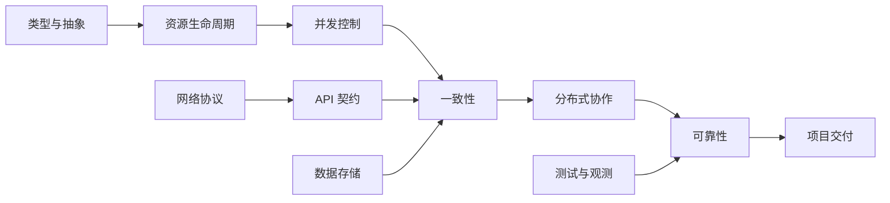

> [!abstract] 主题导航
> 目录回答“笔记放在哪里”，标签回答“同一个问题还出现在哪里”。图中的箭头表示常见的理解或验证方向，不代表固定学习顺序。

# 机制如何连接

例如，并发修改共享状态时要定义一致性条件；缓存和消息引入副本或重试后，一致性边界会扩展到多个组件。测试与观测用于检验可靠性目标，而不是凭图推断系统一定可靠。

# 按问题查笔记

| 问题 | 机制与实现 | 验证与应用 |
| --- | --- | --- |
| 对象何时失效，谁负责释放？ | [C++ RAII](<../03-C++ Backend (C++ 后端)/02-Object and Resource Model (对象与资源模型)/06-RAII and Custom Allocation (RAII 与自定义分配).md>) · [Python 上下文管理](<../04-Python Engineering (Python 工程)/01-Python Foundations (Python 基础)/08-Exceptions Context Managers and Typing (异常、上下文与类型).md>) | [跨语言资源生命周期](<../11-Projects (项目实践)/03-Engineering Decision Records (工程决策记录)/01-Resource Lifetime (资源生命周期).md>) |
| 并发操作怎样保持不变量？ | [同步原语](<../01-Foundations (基础能力)/01-CS Core (计算机核心)/10-Synchronization Primitives (同步原语).md>) · [Go 取消传播](<../05-Go Backend (Go 后端)/02-Concurrency and Runtime (并发与运行时)/02-Context Cancellation and Errors (取消传播与错误).md>) | [InnoDB 事务与隔离](<../07-Data Systems and Distributed Computing (数据系统与分布式)/01-MySQL and SQL (MySQL 与 SQL)/05-Transactions and Isolation (事务与隔离级别).md>) |
| 请求如何跨越网络和服务边界？ | [TCP 流式分帧](<../06-Systems and Networking (系统与网络)/02-Network Protocols (网络协议)/04-TCP Stream Framing (TCP 流式分帧).md>) · [Go HTTP 服务](<../05-Go Backend (Go 后端)/03-Web Services (Web 服务)/01-HTTP JSON and Middleware (HTTP JSON与中间件).md>) | [HTTP 服务设计](<../11-Projects (项目实践)/03-Engineering Decision Records (工程决策记录)/04-HTTP Service Design (HTTP 服务设计).md>) |
| 副本、缓存和消息怎样保持可解释的结果？ | [缓存一致性](<../07-Data Systems and Distributed Computing (数据系统与分布式)/02-Cache and Proxy (缓存与代理)/03-Cache Consistency Problems (缓存一致性问题).md>) · [Kafka 投递与幂等](<../07-Data Systems and Distributed Computing (数据系统与分布式)/03-Messaging and Streaming (消息与流)/02-Kafka Delivery and Idempotency (Kafka 投递与幂等).md>) | [分布式事务](<../07-Data Systems and Distributed Computing (数据系统与分布式)/04-Distributed Fundamentals (分布式基础)/04-Distributed Transactions (分布式事务).md>) |
| 怎样证明服务可靠且可诊断？ | [测试策略](<../02-Engineering Fundamentals (工程基础)/03-Verification and Diagnostics (验证与诊断)/01-Testing Strategy and Evidence (测试策略与证据).md>) · [可观测性](<../02-Engineering Fundamentals (工程基础)/03-Verification and Diagnostics (验证与诊断)/05-Observability Logs Metrics and Tracing (可观测性、日志、指标与追踪).md>) | [SLO 与告警](<../08-Cloud Native and Reliability (云原生与可靠性)/03-Reliability Engineering (可靠性工程)/01-SLO Error Budgets and Alerting (SLO、错误预算与告警).md>) |

# 标签范围

`language/cpp`、`language/python`、`language/go` 只表示笔记的主要语言；跨语言共性用 `topic/*`。以下分组仅供查找，同一标签可服务多个问题。

| 视角 | 标签 |
| --- | --- |
| 基础机制 | `topic/systems` · `topic/math` · `topic/algorithms` · `topic/data-structures` · `topic/type-systems` · `topic/resource-management` |
| 并发与数据 | `topic/concurrency` · `topic/consistency` · `topic/databases` · `topic/caching` · `topic/messaging` · `topic/distributed-systems` |
| 服务接口 | `topic/networking` · `topic/api` · `topic/data-processing` · `topic/error-handling` · `topic/security` |
| 验证运行 | `topic/testing` · `topic/debugging` · `topic/observability` · `topic/performance` · `topic/reliability` |
| 工程实践 | `topic/build` · `topic/cloud-native` · `topic/system-design` · `topic/project-delivery` · `topic/ai` |
| 学习表达 | `topic/learning` · `topic/documentation` · `topic/career` |

需要学习顺序时看[学习周期](<./09-Study Cycle (学习周期).md>)；标签只用于找相关笔记，不记录进度或先修关系。
