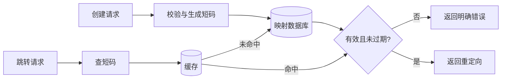

> [!abstract] 本篇要点
> 短链接系统的核心是短码到目标地址的可靠映射。先明确创建、跳转、过期和滥用治理，再按真实读写量决定缓存与扩容方式。

# 需求与边界

- 创建：校验目标 URL、租户权限和自定义短码冲突；成功后返回短码。
- 跳转：区分不存在、过期、停用与有效短码；重定向状态码取决于地址是否允许修改、是否需要统计以及客户端缓存策略。
- 非目标：点击统计、二维码和自定义域名可独立扩展，不应阻塞最小读写闭环。
- 安全：拒绝危险 URL scheme，限制创建频率，并为恶意跳转保留停用和审计能力。

# 容量先算再选型

设每日新增短链为 `W`，平均每天跳转为 `R`，保留 `T` 天，则活跃映射约为 `W × T`；平均写入与跳转速率分别约为 `W / 86400`、`R / 86400`，还要根据实际峰谷计算峰值。短码若使用 `k` 位 Base62，理论空间为 `62^k`，可用容量还受保留码、分配策略和碰撞处理影响。缓存容量要根据热点分布与键值实际内存测量，不能只把字符串字节数相加。

# 数据与请求路径

最小记录包含 `short_code`（唯一）、`target_url`、`owner_id`、`status`、`expires_at` 和创建时间。数据库唯一约束负责最终防重；随机短码冲突时有限次重试，顺序 ID 编码则要评估可枚举性。

缓存只保存派生映射。创建成功后可预热；修改、停用或过期必须使旧缓存失效。缓存未命中时限制并发回源，缓存填充要考虑与更新并发的版本竞争。若地址允许变化或必须逐次计数，通常避免给浏览器长期缓存的永久重定向。

# 失败与验证

- 数据库写入成功但响应丢失：用请求幂等键或查询创建结果，不能盲目重复分配短码。
- 热点短码与缓存失效：测回源峰值、缓存命中和延迟；先限制并发，再决定是否增加本地缓存。
- 到期与停用：验证缓存命中时仍遵守有效期和状态，必要时用短 TTL 或显式失效。
- 统计链路失败：若统计不是跳转的硬依赖，应明确降级与丢失预算。

# 面试追问

1. 随机短码与顺序 ID 编码分别怎样保证唯一、处理冲突和限制枚举？
2. 为什么“缓存命中率 99%”不能单独证明系统可承受热点失效？
3. `301` 与 `302` 对浏览器缓存、地址变更和点击统计有什么影响？

# 考察题目

## 1. 动手题

按创建量、跳转量与保留期估算短码空间、索引和缓存；给出一次热点失效处理方案。

> [!note]- 验收要点
> 单位与假设自洽，碰撞概率、缓存旧值和恶意跳转风险有边界。

## 2. 机制追问

短链接系统容量估算应从哪些量开始，而不是直接选数据库？

> [!note]- 参考答案
> 从创建量、跳转读量、保留期、短码空间和热点分布推导数据与流量，再决定索引、缓存和冲突策略。
