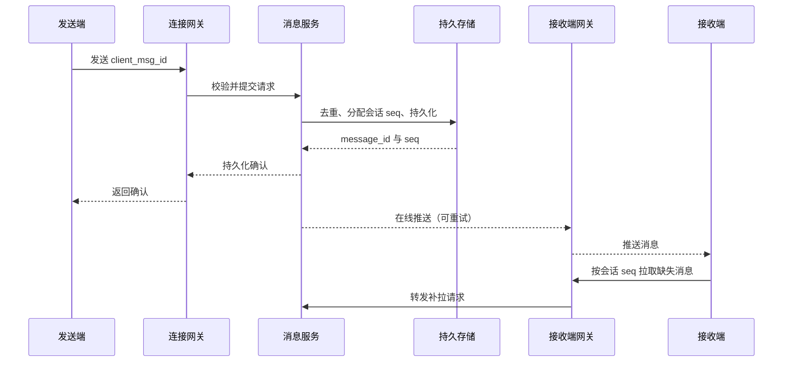

> [!abstract] 本篇要点
> 即时通信先保证消息持久化、去重和离线恢复，再讨论在线推送。顺序必须说明范围：单会话、单用户多设备或全局顺序的成本不同。

# 需求与数据契约

最小范围是单聊：发送、服务端确认、在线推送、离线拉取与多设备去重。发送请求包含 `conversation_id`、`sender_id`、客户端生成的 `client_msg_id` 和内容；服务端持久化后返回 `message_id` 与会话内 `seq`。对 `(conversation_id, sender_id, client_msg_id)` 建立唯一约束，使确认丢失后的重试返回同一结果。

在线状态是提示，不是消息真相。长连接网关持有连接、心跳和写缓冲状态；消息存储与会话游标才负责断线恢复。已持久化、已送达和已读是三个不同状态。

# 发送与恢复路径

确认必须在持久化成功后发送；在线推送失败不应抹掉已持久化消息。接收端用会话游标补拉，并按 `message_id` 去重。群聊可在明确成员规模、延迟目标与读写成本后选择写扩散或读扩散，不预设固定人数阈值。

# 故障与边界

- 服务端已提交、发送端未收到确认：相同 `client_msg_id` 重试，返回原消息而非再创建。
- 接收端断线或慢消费：保留有界写缓冲，超过阈值断开并让客户端从游标补拉。
- 多设备：分别维护设备游标；“已读”是否跨设备同步由产品契约决定。
- 消息顺序：会话内 `seq` 可用于展示顺序；跨会话全局顺序通常不需要。

# 验证

模拟重复发送、确认丢失、断线重连、乱序到达、慢客户端和多设备同时在线。检查消息只持久化一次、游标无缺口、重复推送不重复展示，并记录端到端延迟与积压。

# 考察题目

## 1. 动手题

设计单聊消息的发送、持久化、确认和离线补发时序；注入发送成功但确认丢失。

> [!note]- 验收要点
> 消息 ID 去重、顺序范围与多设备状态明确，重试不产生重复展示。

## 2. 机制追问

IM 系统要求“消息有序”，先要澄清什么范围？

> [!note]- 参考答案
> 明确单会话、单用户、多设备还是全局顺序，以及服务器接收、持久化和展示顺序；不同范围对应不同成本与故障处理。
