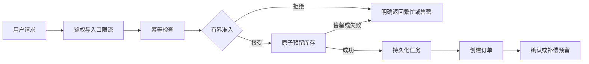

> [!abstract] 本篇要点
> 秒杀系统先守住库存不超卖与用户不重复下单，再控制入口和排队容量。异步队列能削峰，但不能替代库存原子性、幂等和失败恢复。

# 需求与容量

明确活动库存 `S`、单用户限购、峰值请求速率 `λ`、数据库持续处理速率 `μ` 和可接受等待时间。若 `λ > μ`，积压会持续增长；入口必须限流或拒绝，队列必须有容量和超时。不要把某个示例 QPS 当成通用系统指标。

# 正确性基线

最小可行方案是数据库事务：对 `(activity_id, user_id)` 建唯一约束，按 `stock > 0` 条件扣减库存并创建订单；事务失败时回滚。响应超时后先查询幂等结果，不能直接重复扣减。

当单库不能满足测得的峰值，再引入预留库存和异步下单：预留记录要有唯一请求 ID、状态和可恢复期限；数据库订单与预留库存之间的失败窗口需用对账和补偿闭合。不能把 Redis 扣减成功直接等同于订单成功。

图中“预留 + 队列”是高负载扩展方案，不是最小实现。接受请求后应返回可查询的状态；若服务不能保证任务持久化，就不能向用户承诺一定会下单。

# 验证与观测

- 并发压测：成功订单数不超过库存，单用户至多一单；失败与取消不会永久占用库存。
- 故障注入：预留成功但入队失败、消费者重复执行、订单提交后确认丢失、队列积压超过预算。
- 观测：准入拒绝率、预留与订单差额、任务年龄、数据库延迟和补偿次数；每个指标都要附负载条件。

# 考察题目

## 1. 动手题

给定峰值流量与库存，画入口限流、原子扣减、异步下单和失败补偿链路。

> [!note]- 验收要点
> 无超卖与重复订单，队列和数据库有容量上限；失败有可恢复状态。

## 2. 机制追问

秒杀系统为什么先做限流和库存不变量，再谈消息队列？

> [!note]- 参考答案
> 入口容量必须受控，库存扣减必须原子正确；队列可削峰和异步化，但不能修复超卖、重复下单或无限积压。
